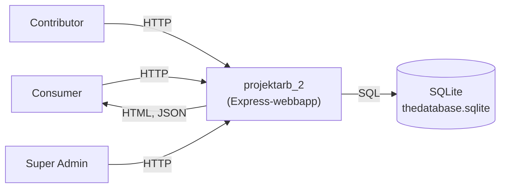
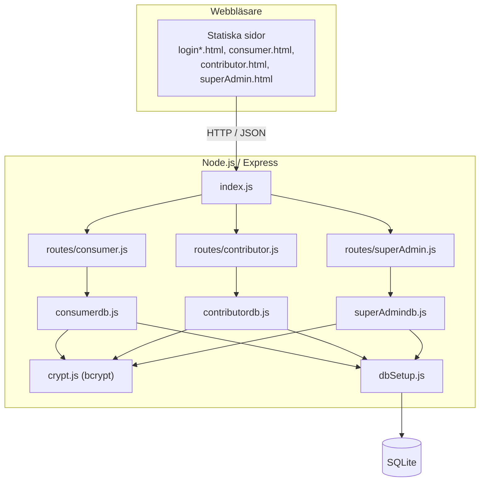
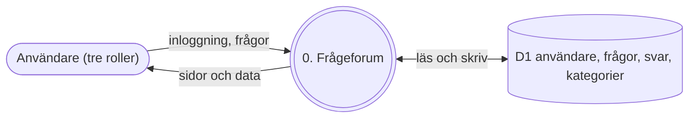
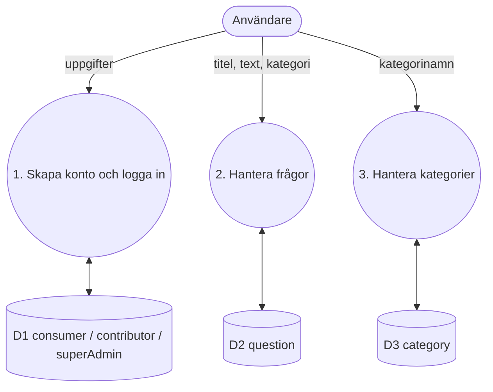
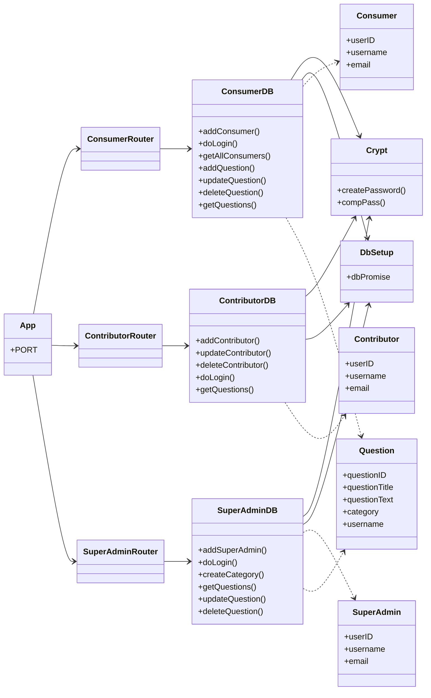
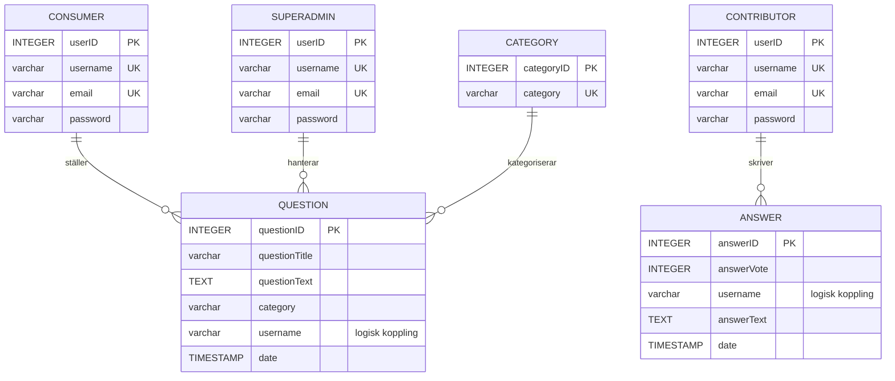
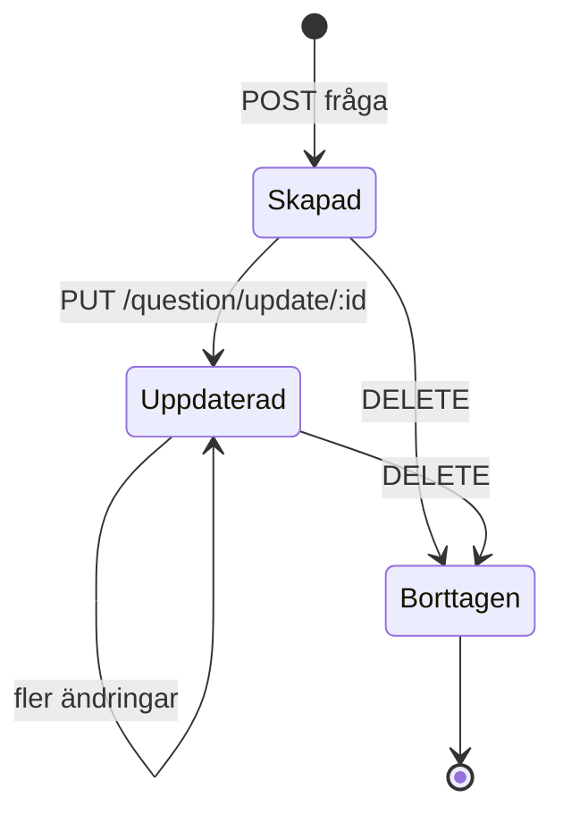
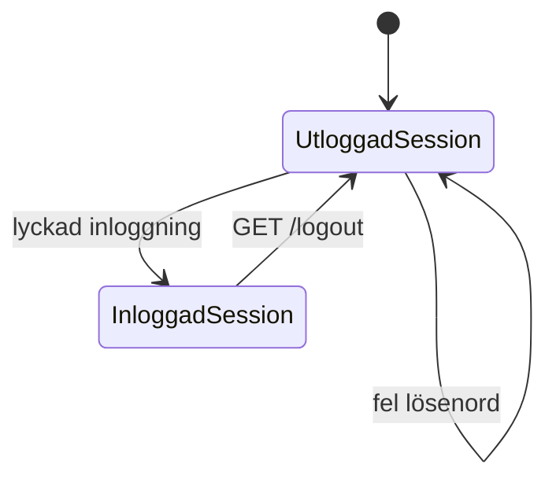
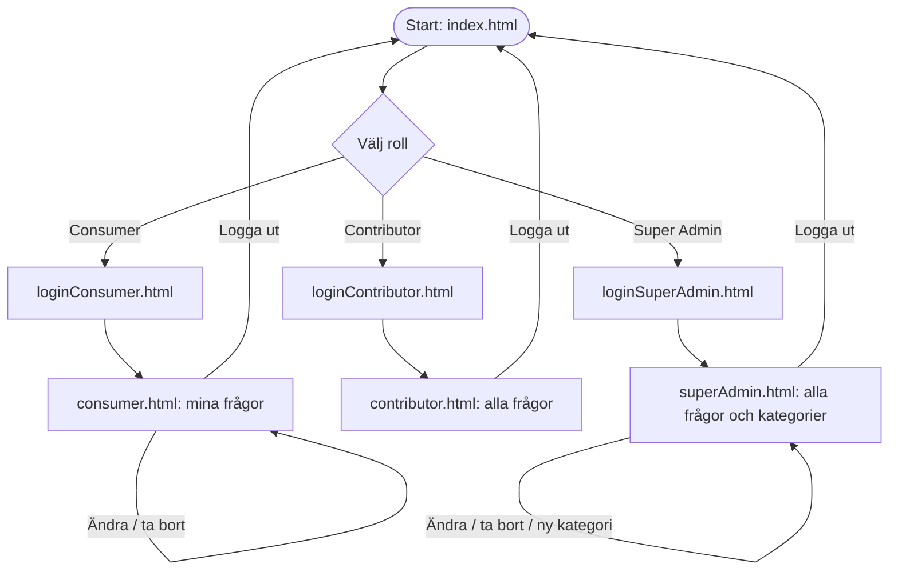
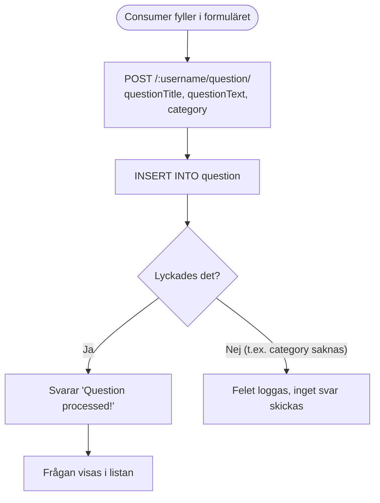

# projektarb_2

Ett frågeforum med tre användarroller, byggt som projektarbete i kursen Dynamiska webbapplikationer. **Consumer** ställer frågor, **Contributor** är tänkt att svara, och **Super Admin** hanterar frågor och kategorier. Varje roll har egen inloggningssida och egen tabell i databasen.

> **Status:** projektet är ett pågående arbete. Frågehantering för Consumer och Super Admin finns, men svarsfunktionen är inte färdig. Se [Kända problem](#kända-problem).

## Innehåll

- [Teknikstack](#teknikstack)
- [Kom igång](#kom-igång)
- [Projektstruktur](#projektstruktur)
- [Sidor och API](#sidor-och-api)
- [Datamodell](#datamodell)
- [Systemkontextdiagram](#systemkontextdiagram)
- [Arkitekturdiagram](#arkitekturdiagram-c4)
- [Dataflödesdiagram](#dataflödesdiagram-dfd)
- [UML-klassdiagram](#uml-klassdiagram)
- [ER-diagram](#er-diagram)
- [Tillståndsdiagram](#tillståndsdiagram)
- [User flows](#user-flows)
- [Flödesschema: ställa en fråga](#flödesschema-ställa-en-fråga)
- [User stories](#user-stories)
- [Wireframes](#wireframes)
- [Klickbar prototyp](#klickbar-prototyp)
- [Agila metoder](#agila-metoder)
- [CI/CD](#cicd)
- [Kända problem](#kända-problem)

## Teknikstack

| Del | Teknik |
| --- | --- |
| Server | Node.js, Express 4 |
| Databas | SQLite (`sqlite`, `sqlite3`) |
| Lösenord | bcrypt |
| Sessioner | express-session |
| Frontend | Statiska HTML-sidor och CSS |

## Kom igång

Krav: Node.js 18 eller senare.

```bash
npm install
npm start          # startar på http://localhost:3055
```

Porten kan ändras med miljövariabeln `PORT`.

Databasen ligger i `thedatabase.sqlite` och tabellerna definieras i `sql.sql`. Exempelanrop finns i `request.rest`.

## Projektstruktur

```
.
├── index.js                 # Startar Express och monterar de tre routrarna
├── crypt.js                 # bcrypt: createPassword och compPass
├── routes/
│   ├── consumer.js          # Consumer: konto, inloggning, egna frågor
│   ├── contributor.js       # Contributor: konto och inloggning
│   └── superAdmin.js        # Super Admin: inloggning, frågor, kategorier
├── database/
│   ├── dbSetup.js           # Öppnar SQLite
│   ├── consumerdb.js
│   ├── contributordb.js
│   └── superAdmindb.js
├── public/                  # index, loginConsumer/Contributor/SuperAdmin, consumer, contributor, superAdmin
├── docs/prototype.html      # Klickbar prototyp
├── sql.sql                  # Skapar tabellerna
└── request.rest             # Exempelanrop
```

## Sidor och API

Alla tre routrar är monterade på `/`.

### Consumer

| Metod | Sökväg | Beskrivning |
| --- | --- | --- |
| POST | `/consumer/add` | Skapar ett Consumer-konto. |
| POST | `/consumer/login/` | Loggar in. |
| GET | `/consumers/` | Hämtar alla Consumers. |
| GET | `/consumer/:username` | Hämtar en Consumer. |
| POST | `/:username/question/` | Ställer en fråga (`questionTitle`, `questionText`, `category`). |
| GET | `/questions/:username/` | Hämtar en användares frågor. |
| PUT | `/question/update/:id` | Uppdaterar titel och text. |
| DELETE | `/question/delete/:id` | Tar bort en fråga. |
| GET | `/logout` | Avslutar sessionen. |

### Contributor

| Metod | Sökväg | Beskrivning |
| --- | --- | --- |
| POST | `/contributor/` | Skapar ett Contributor-konto. |
| POST | `/contributor/login/` | Loggar in. |
| GET | `/contributor/:username` | Hämtar en Contributor. |
| PATCH | `/contributor/update/:id` | Uppdaterar konto. |
| DELETE | `/contributor/:id` | Tar bort konto. |

### Super Admin

| Metod | Sökväg | Beskrivning |
| --- | --- | --- |
| POST | `/superadmin/` | Skapar ett Super Admin-konto. |
| POST | `/superadmin/login/` | Loggar in. |
| POST | `/question/:category/add` | Lägger till en fråga i en kategori. |
| GET | `/question/all/` | Hämtar alla frågor. |
| GET | `/question/:id` | Hämtar en fråga. |
| PUT | `/question/update/:id` | Uppdaterar titel, kategori och text. |
| DELETE | `/question/delete/:id` | Tar bort en fråga. |

## Datamodell

| Tabell | Innehåll |
| --- | --- |
| `consumer`, `contributor`, `superAdmin` | Användarnamn, e-post, bcrypt-hashat lösenord och `userID`. Tre separata tabeller med samma kolumner. |
| `question` | Titel, text, kategori, författare (`username`) och datum. |
| `answer` | Svarstext, röstvärde, författare och datum. |
| `category` | Unika kategorinamn. |

## Systemkontextdiagram



## Arkitekturdiagram (C4)



## Dataflödesdiagram (DFD)

### Nivå 0



### Nivå 1



## UML-klassdiagram



## ER-diagram



`answer` har ingen kolumn som pekar på en fråga, så ett svar kan i nuvarande schema inte kopplas till sin fråga. Alla relationer är logiska, eftersom inga främmande nycklar är definierade.

## Tillståndsdiagram





## User flows



## Flödesschema: ställa en fråga



## User stories

1. **Som besökare** vill jag välja roll och logga in, så att jag kommer till rätt sida.
2. **Som Consumer** vill jag skapa ett konto, så att jag kan ställa frågor.
3. **Som Consumer** vill jag ställa en fråga i en kategori, så att den hamnar rätt.
4. **Som Consumer** vill jag ändra eller ta bort mina frågor, så att jag kan rätta misstag.
5. **Som Contributor** vill jag se alla frågor, så att jag kan välja vilka jag svarar på.
6. **Som Contributor** vill jag svara på en fråga, så att jag kan hjälpa andra. *(Ej färdig i backend.)*
7. **Som Super Admin** vill jag redigera och ta bort alla frågor, så att forumet hålls städat.
8. **Som Super Admin** vill jag skapa kategorier, så att frågorna blir organiserade.

## Wireframes

```
Startsida
+--------------------------------------------+
| Frågeforum                                 |
| [ Consumer ]  [ Contributor ]  [ Super Admin ] |
+--------------------------------------------+

Inloggning
+--------------------------------------------+
| Logga in som Consumer                      |
| Användarnamn [______________]              |
| Lösenord     [______________]              |
|                         [ Logga in ]       |
+--------------------------------------------+

Consumer
+--------------------------------------------+
| Hej, namn                      [Logga ut]  |
| [ + Ny fråga ]                             |
| Titel     Kategori   [Ändra] [Ta bort]     |
| Titel     Kategori   [Ändra] [Ta bort]     |
+--------------------------------------------+

Super Admin
+--------------------------------------------+
| Alla frågor            [ + Ny kategori ]   |
| Titel   Kategori   Författare  [Ändra] [Ta bort] |
+--------------------------------------------+
```

## Klickbar prototyp

[`docs/prototype.html`](docs/prototype.html) visar flödet mellan de tre rollerna med exempeldata. Öppna filen i en webbläsare. Inget sparas permanent, och svarsfunktionen visas som den är tänkt att fungera.

## Agila metoder

Projektet passar en enkel Kanban-tavla med kolumnerna **Backlog**, **Redo**, **Pågående** (max två kort per person), **Granskning** och **Klar**. Varje user story ovan blir ett kort. Första prioritet bör vara att färdigställa svarsfunktionen. Vill gruppen köra Scrum fungerar sprintar på en vecka med sprintplanering, kort daglig avstämning, sprintgranskning och retrospektiv.

## CI/CD

[`.github/workflows/ci.yml`](.github/workflows/ci.yml) körs vid varje push till `main` och på pull requests. Den installerar beroenden med `npm ci` och kontrollerar syntaxen i alla JavaScript-filer. Det finns inga automatiska tester, och Continuous Delivery är inte uppsatt.

## Kända problem

Det här är observationer från genomgången. Inget av det är åtgärdat i koden.

- **Svar går inte att spara.** `answer`-tabellen saknar koppling till frågan, och `contributordb.addAnswer` skriver till kolumnerna `formID` och `answers` som inte finns.
- **Referenser till borttagna tabeller.** `getMatchingFormID` använder `queryCollection` och `question.formID`, men tabellen är bortkommenterad i `sql.sql`.
- **Felstavat funktionsnamn.** `routes/consumer.js` anropar `bcrypt.comparePass`, men `crypt.js` exporterar `compPass`.
- **Rutter skuggar varandra.** Varje router har `/:username` först, och den matchar alla sökvägar med ett enda led. Samma sökväg är också definierad flera gånger, till exempel `POST /consumer/login/` två gånger och `/question/update/:id` i både Consumer och Super Admin.
- **Fel filsökväg.** Rutterna skickar `__dirname + '/public/...'`, men `__dirname` är `routes/`, så filen hittas inte. Sökvägen bör vara `path.join(__dirname, '..', 'public', ...)`.
- **Ingen validering eller behörighetskontroll.** Rutterna kontrollerar varken indata, inloggning eller roll. Om `category` saknas misslyckas INSERT:en och anropet får aldrig något svar.
- **Tre användartabeller med samma kolumner.** De kan slås ihop till en `users`-tabell med en `role`-kolumn, som i [WebbApplicProject](https://github.com/Thedoniki/WebbApplicProject).
- **Hårdkodad sessionshemlighet.** `thisisasecret` används i alla tre routrar och bör läsas från en miljövariabel.
- **Ingen `.gitignore`.** `node_modules` och `.env` bör hållas utanför git.
- Det finns inga automatiska tester.
